# Validación visual del rediseño

Capturas de página completa tomadas con el navegador de la aplicación el 2 de noviembre de 2026.

- **Escritorio:** 1440 px de ancho.
- **Móvil:** 390 px de ancho (portada).
- **Rutas comprobadas:** `/`, `/explorador`, `/linea-del-tiempo`, `/historia`, `/factores`, `/minijuegos`, `/fuentes`, `/acerca`.

## Portada

| Antes | Después |
| --- | --- |
| 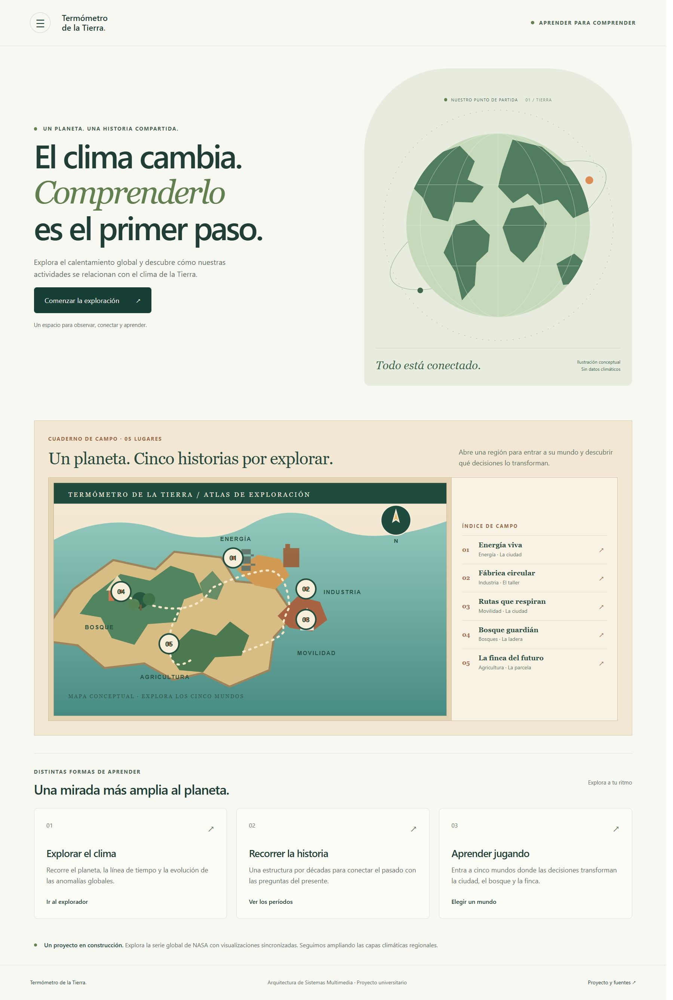 | 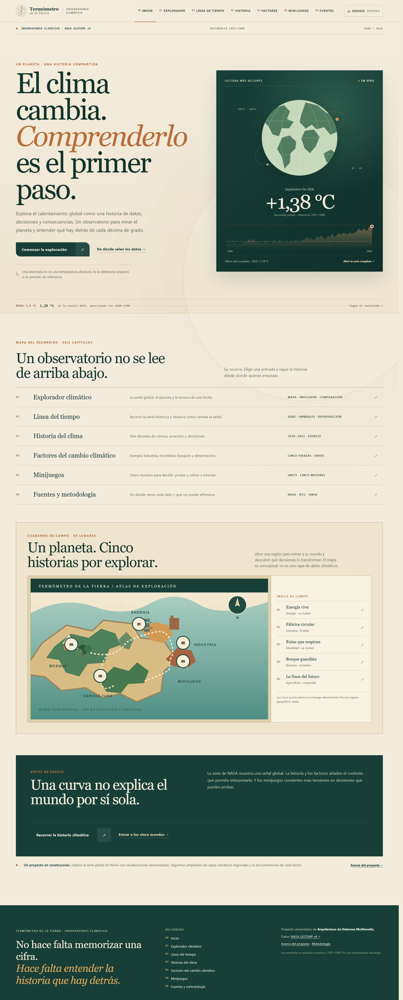 |

## Explorador climático

| Antes | Después |
| --- | --- |
| 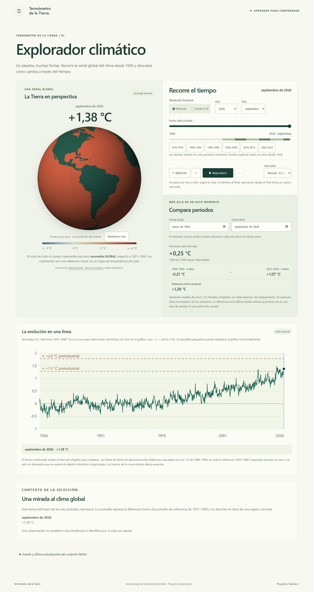 | 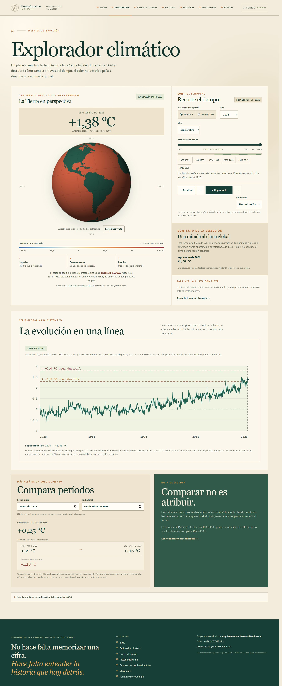 |

## Línea del tiempo

La ruta `/linea-del-tiempo` es nueva. Antes, los controles temporales vivían dentro del explorador; la captura «antes» muestra esa composición anterior.

| Antes: controles dentro del explorador | Después: sala de instrumentos |
| --- | --- |
|  | 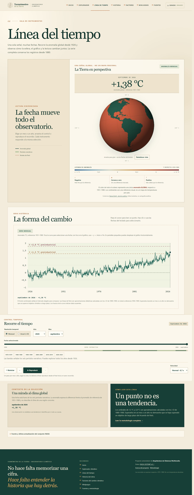 |

## Historia del clima

| Antes | Después |
| --- | --- |
|  | 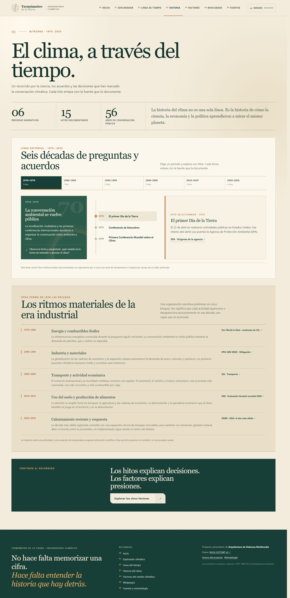 |

## Factores del cambio climático

La ruta `/factores` es nueva. No existía una página equivalente; la captura «antes» usa Historia como el contenido previo más cercano.

| Antes: contexto histórico | Después: cinco factores |
| --- | --- |
| 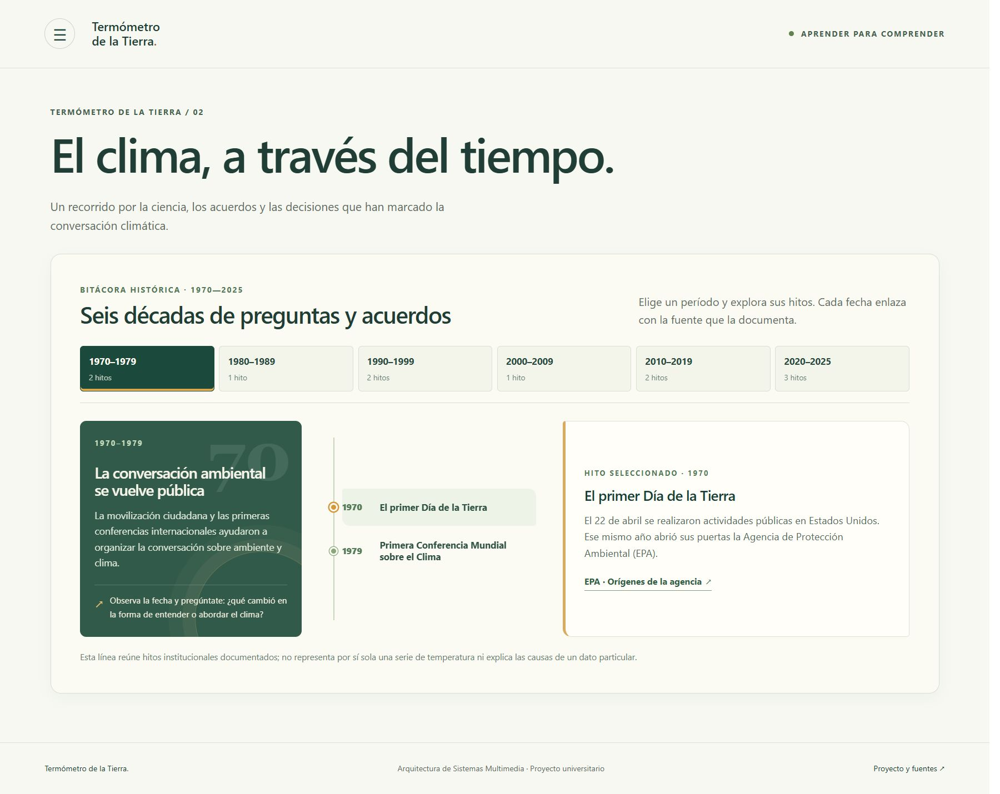 | 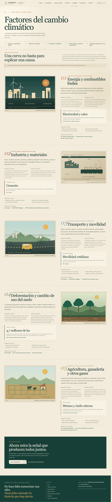 |

## Minijuegos

| Antes | Después |
| --- | --- |
| 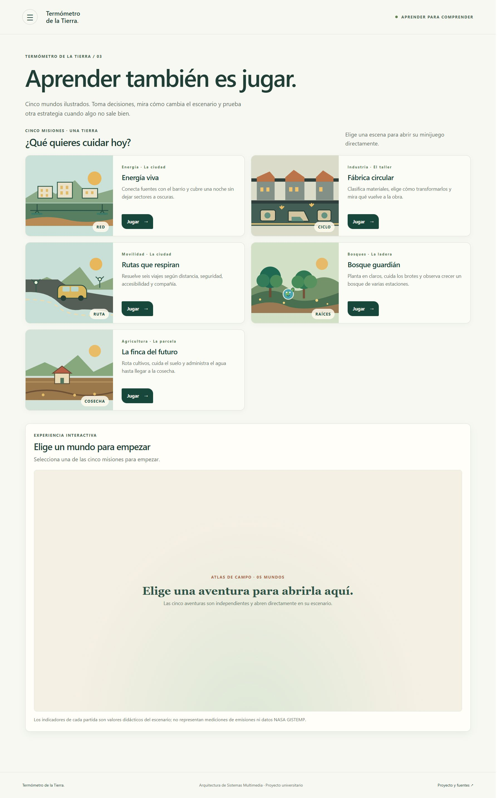 | 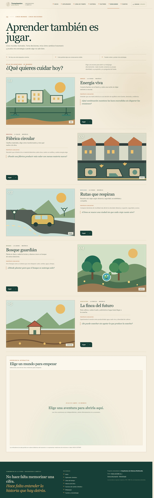 |

## Portada en móvil

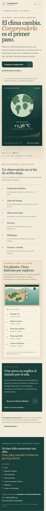

## Comprobaciones realizadas

- `npm.cmd test`: **62 pruebas superadas**.
- `npm.cmd run build`: TypeScript estricto y build de Vite correctos.
- Sin errores de consola en las rutas comprobadas.
- Sin desbordamiento horizontal a 1440 px ni a 390 px (`scrollWidth` igual o menor que `clientWidth`).
- El explorador sincroniza fecha, anomalía, marcador del gráfico, contexto histórico y lectura al cambiar de año.
- El audio permanece apagado por defecto, recuerda volúmenes y solo crea el contexto Web Audio tras activarlo.
- El menú móvil abre con el botón, bloquea el fondo, cierra con Escape y devuelve el foco al disparador.
- Se conservan los enlaces profundos de Unity (`world=` y `return=`) y el iframe con su título accesible.
